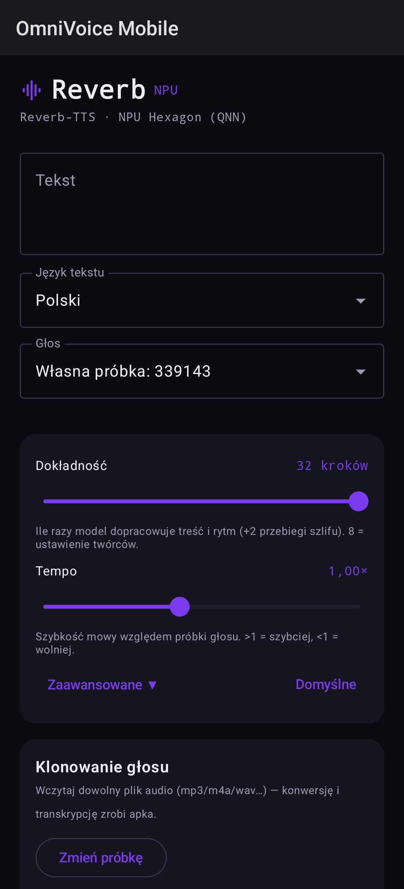

# Reverb

  

Polskie (i 6 innych języków) TTS z klonowaniem głosu, działające w całości na telefonie — model
[Reverb-TTS](https://huggingface.co/software-mansion/Reverb-TTS) (Software Mansion, fine-tune OmniVoice)
liczony na NPU Hexagon (Qualcomm QNN), dekoder audio na CPU.

**Wymaga:** telefonu ze Snapdragon 8 Elite (Hexagon V79), np. Galaxy Z Fold7.

APK: zakładka **Releases** albo sklep **LABstore** (DK-LAB).

Wagi modelu Reverb-TTS: © Software Mansion, licencja [CC BY-NC 4.0](https://creativecommons.org/licenses/by-nc/4.0/) — tylko do użytku niekomercyjnego.
